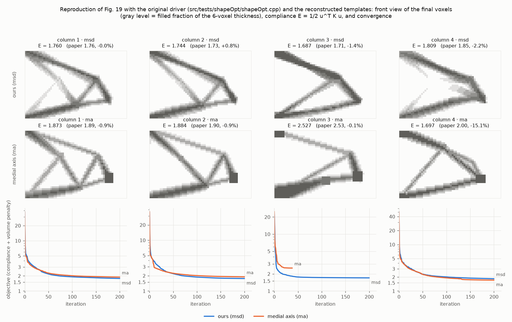

# msd_shape_opt — topology-constrained shape optimization with the Medial Skeletal Diagram

This is the shape-optimization application of Sec. 6.2.1 of

> Minghao Guo\*, Bohan Wang\*, Wojciech Matusik. *Medial Skeletal Diagram: A Generalized Medial Axis Approach for 3D
> Shape Representation.* ACM Trans. Graph. 43(6) (SIGGRAPH Asia 2024). [arXiv:2310.09395](https://arxiv.org/abs/2310.09395)

carved out of the `medial-axis` research code base with minimal changes (see [CARVEOUT.md](CARVEOUT.md)), extended
with a JSON front end so that **any 3D skeletal graph** with any boundary conditions can be optimized, and with a
**web interface** that shows the optimized shape and its compliance, the convergence curves, and the optimization
process (live and as a replay).

**The problem.** A skeletal graph (vertices + edges) fixes the topology of the shape. Every vertex carries a
"sphere" primitive (8 radii, one per template direction) and every edge a "cylinder" primitive (14 radii). The union of
the primitives, expressed with an R-function and a smoothed Heaviside step, gives a density `theta_i` for every voxel of
a regular design grid. With linear-elastic hexahedral FEM, the code minimizes the compliance

    E = 1/2 u^T K(theta) u     s.t.  K(theta) u = f,   sum_i theta_i <= V_vol |Omega|,   u = 0 on the fixed vertices

over the vertex positions and the radii by gradient descent with a back-tracking line search (the volume constraint is a
quadratic penalty; gradients by the adjoint method, Appendix A of the paper). Because the optimization variables live on
the skeleton, the topology of the result is the topology of the input graph. Two parameterizations are available:
`msd` (the paper's generalized enveloping primitives) and `ma` (the medial-axis baseline of the paper: one radius per
sphere, cones on the edges).

---

## Quick start

Prerequisites (same as [libpgo](https://github.com/bohanwang/libpgo)): Linux, CMake >= 3.28, GCC 11-13, `ninja`
(optional), `libgmp-dev` and `libmpfr-dev`, and conda (e.g. miniforge).

```bash
scripts/setup_env.sh     # conda env "msd_shape_opt": python 3.12, tbb, tbb-devel, mkl, mkl-devel (+ fastapi, uvicorn)
scripts/build.sh         # configures (downloads the other dependencies) and builds build/bin/{msdShapeOpt,shapeOpt,makeTemplates}

# command line
build/bin/msdShapeOpt examples/cantilever_truss.json -o runs/truss        # ~1 minute
build/bin/msdShapeOpt examples/fig19_case0.json      -o runs/fig19_case0  # ~6 minutes on 16 cores (paper Fig. 19, column 1)

# web interface (binds to 127.0.0.1:17860)
scripts/run_web.sh
```

`msdShapeOpt <config.json> [-o <dir>] [--threads n] [--templates <dir>] [--validate-only]` writes everything into the
output directory (see [Output](#output)); `--validate-only` checks a configuration and prints a JSON summary.

### Opening the web interface from your own computer

The server is headless, so the interface is served over HTTP and opened in a browser on your machine. Two ways:

* **SSH tunnel** (works everywhere, nothing exposed):
  `ssh -p <ssh port> -L 17860:127.0.0.1:17860 root@<server ip>`, then open <http://localhost:17860>.
* **Vast.ai instance** (as installed on this machine): `scripts/install_vast_service.sh [external_port]` registers the
  web interface as a supervisor service (`supervisorctl status msd-shape-opt`) behind the instance's token-authenticated
  Caddy edge. Open `http://<PUBLIC_IPADDR>:<VAST_TCP_PORT_<external_port>>/?token=<OPEN_BUTTON_TOKEN>` once; the token is
  then kept in a cookie. (`echo $PUBLIC_IPADDR $VAST_TCP_PORT_10100 $OPEN_BUTTON_TOKEN` on the server prints the values.)

---

## Input: the JSON configuration

All lengths are in **voxels**. Internally the grid has the voxel size of the paper (0.01): the constants of the
original implementation (minimal primitive radius 0.02, width of the smoothed Heaviside 0.01, initial radius 0.04, ...)
are absolute lengths tuned for it, so the driver maps every problem onto that scale rather than changing them.

```jsonc
{
  "name": "fig19_case0",                         // optional
  "description": "...",                          // optional
  "grid": { "resolution": [60, 40, 6] },         // number of voxels along x, y, z
  "skeleton": {
    "coordinates": "voxel",                      // "voxel": integer i = center of voxel i (default) | "grid": integer i = grid plane i
    "vertices": [[0, 10, 2], [30, 10, 2], [50, 10, 2], [0, 30, 2], [50, 30, 2], [15, 20, 2]],
    "edges":    [[0, 1], [1, 2], [3, 4], [2, 4], [1, 4], [1, 5], [3, 5], [0, 5]]
  },
  "boundary_conditions": {                       // selectors of grid vertices (integer grid coordinates 0..n)
    "fixed": [ { "type": "face", "face": "x-" } ],
    "loads": [ { "type": "box", "min": [50, 10, 0], "max": [50, 10, 6], "force": [0, -10, 0] } ]
  },
  "optimization": {
    "volume_fraction": 0.2,                      // V_vol (default 0.2)
    "method": "msd",                             // "msd" (paper) | "ma" (medial-axis baseline)
    "max_iterations": 200,                       // default 200 (as in the paper)
    "initial_radius": 4                          // initial radius of all primitives, in voxels (default 4 = 0.04)
  },
  "output": { "keep_iteration_objs": false }     // keep the original optimizer's per-iteration OBJ files
}
```

**Selectors** (each selects a set of grid vertices; `fixed` vertices are clamped in x, y and z):

| type | fields | selects |
|---|---|---|
| `face` | `face`: `x-` `x+` `y-` `y+` `z-` `z+` | all grid vertices of a face of the domain |
| `box` | `min`, `max` (grid coordinates, inclusive) | the grid vertices inside the box (also planes, lines, points) |
| `sphere` | `center`, `radius` (voxels), `coordinates` (`grid` default, or `voxel`) | grid vertices closer than `radius` to `center` |
| `vertex` | `vertex` (skeleton vertex index), `radius` (voxels, default 2) | grid vertices closer than `radius` to that skeleton vertex (Fig. 20's supports and load) |
| `points` | `points`: `[[i, j, k], ...]` | explicit grid vertices |

A load is a selector plus either `force` (applied to **every** selected grid vertex, as in the paper's code) or
`total_force` (split evenly). Forces of overlapping loads add up.

The driver validates everything and explains what is wrong: out-of-domain vertices, self-loops, duplicate edges,
coincident vertices, selectors that select nothing, fixed sets that leave rigid-body motions (fewer than three
non-collinear clamped vertices make the stiffness matrix singular), loads that act only on clamped vertices, unknown keys
(warnings), grids above 500k voxels (unless `"allow_large_grid": true`; the web server refuses more than 5M in any case),
initial radii below 2 voxels (the implementation's minimal radius: smaller radii have a zero gradient), non-finite or huge
loads, and so on; a run that diverges (non-finite compliance) stops with an error. One silent pitfall of the original code
is avoided for the input graph: `EdgeRFunction` builds the rotation from +x to the edge direction and uses the identity
whenever the edge is (anti)parallel to x, which puts the primitive on the wrong side for edges pointing along **-x**; such
edges are given with their end points swapped (same edge, listed in `meta.json` as `flipped_edges`). An edge that turns to
point exactly along -x *during* the optimization is not caught (not observed in any run).

### Examples (`examples/`)

| file | what | voxels | time (16 cores) |
|---|---|---|---|
| `random2d_{1..4}.json` | random planar graphs (cantilever, bridge, random load) from `scripts/random_2d_graphs.py`, 120 iterations | 6,000 | ~1 min |
| `cantilever_truss.json` | the truss of the repository's unfinished `topologyOptTest`, as a clamped cantilever | 7,200 | ~3 min |
| `fig19_case{0,1,5,3}.json` | the four columns of the paper's Fig. 19 (left face clamped, point load) | 14,400 | ~6 min |
| `table_3d.json` | a fully 3D table-like graph: pinned feet, load at the center of the top | 38,400 | ~50 min |
| `fig20_grid.json` | the paper's Fig. 20 (3x3 grid graph, 4 corner supports, central load, V_vol = 0.05); the code's domain is 60x30x60 (the text says 60x60x40) | 108,000 | ~4 h |

Times are for 200 iterations (the default) on the 8-core / 16-thread test machine. Every iteration runs ~8 FEM solves
(gradient + back-tracking line search); per iteration: 0.9 s (7.2k voxels), 1.8 s (14.4k), 15 s (38.4k, truly 3D),
71 s (108k). Thin, quasi-2D slabs are much cheaper than 3D grids with the same number of voxels. More random graphs:
`python3 scripts/random_2d_graphs.py --count 6 --seed 1 --out my_graphs`.

---

## Output

`msdShapeOpt` writes into the output directory (format details: [docs/WEB_API.md](docs/WEB_API.md)):

| file | content |
|---|---|
| `result.json` | final state: compliance, volume fraction, energy, iterations, convergence flag, elapsed time |
| `history.jsonl` | one record per iteration: compliance `1/2 u^T K u`, volume penalty, objective, volume fraction, gradient norm, step, skeleton vertices, ... |
| `final_voxels.obj` | the optimized shape as voxels (`theta > 0.5`), as written by the original code |
| `final_primitives.obj` | the optimized shape as the union of the generalized enveloping primitives (the boundary of their union is the zero level set of the R-function) |
| `final_skeleton.obj` | the optimized skeletal graph (OBJ lines) |
| `frames/` | per-iteration voxel densities (1 byte per voxel) and primitive meshes, used by the web interface |
| `meta.json`, `config.json` | the problem as understood by the driver (grid, skeleton, clamped vertices, loads, options) |
| `energy.txt`, `initial-sample.obj`, `iterXXXX-*.obj` | the original optimizer's own outputs (`energy.txt` also contains the line-search evaluations) |

The compliance reported everywhere is `E = 1/2 u^T K u`, the quantity printed under the paper's figures.

---

## Web interface

`web/server.py` (FastAPI) queues optimization jobs, runs each as a separate `msdShapeOpt` process (one at a time by
default, `MSD_MAX_CONCURRENT`), and streams their progress with Server-Sent Events; `web/static/` is the single-page
interface. API: [docs/WEB_API.md](docs/WEB_API.md). Runs are stored in `runs/` (`MSD_RUNS_DIR`).

* **Runs list** with live state, queue position, cancel and delete; **New run** panel: pick an example, upload or edit a
  JSON configuration, choose method (msd / ma), volume fraction, iterations, initial radius and threads, then
  *Validate / Preview* (domain, skeleton, fixed grid vertices and loads in 3D before anything runs) and *Run*.
* **Optimized shape**: 3D view of the voxels (density threshold slider), primitives, current and initial skeleton,
  boundary conditions, clipping, camera presets and PNG export, next to the **compliance** card (E = 1/2 u^T K u, volume
  fraction vs. target, energy terms, step size, line-search count, convergence measure).
* **Optimization curve**: compliance and total energy vs. iteration (log scale optional) and volume fraction vs. target.
* **Optimization process**: the view follows a running job live (Server-Sent Events); every iteration is stored, so any
  run can be replayed or scrubbed (play / pause / step / speed, keyboard: space, arrows). Log panel and downloads
  (final voxels / primitives / skeleton as OBJ, history, configuration).

---

## Validation

Three levels of checks (scripts and raw outputs in `validation/`):

1. **The JSON driver is the original optimizer.** For the configuration `examples/fig19_case0.json`, `msdShapeOpt`
   reproduces the original driver `shapeOpt 0 0` exactly: all 23 energy evaluations of the first 5 iterations
   (including line-search trials) in `energy.txt` are textually identical. The grid numbering, voxel-center arithmetic,
   clamped vertices and loads are built exactly as in `shapeOpt.cpp`.
2. **The paper's Fig. 19 is reproduced** with the original, unmodified driver and the reconstructed template primitives
   (`validation/run_paper_fig19.sh`, 200 iterations each, as in the paper). E is the compliance `1/2 u^T K u` of the final
   state; the paper prints it under each shape.

| Fig. 19 column | caseID | method | paper E | compliance (ours) | rel. diff | volume fraction | total energy | iterations |
|---|---|---|---|---|---|---|---|---|
| 1 | 0 | msd (ours) | 1.76 | 1.7596 | -0.0% | 0.2043 | 1.7792 | 200 |
| 2 | 1 | msd (ours) | 1.73 | 1.7444 | +0.8% | 0.2043 | 1.7631 | 200 |
| 3 | 5 | msd (ours) | 1.71 | 1.6869 | -1.4% | 0.2039 | 1.7024 | 200 |
| 4 | 3 | msd (ours) | 1.85 | 1.8094 | -2.2% | 0.2052 | 1.8379 | 200 |
| 1 | 0 | ma (medial axis) | 1.89 | 1.8729 | -0.9% | 0.2043 | 1.8919 | 200 |
| 2 | 1 | ma (medial axis) | 1.90 | 1.8837 | -0.9% | 0.2040 | 1.9006 | 200 |
| 3 | 5 | ma (medial axis) | 2.53 | 2.5269 | -0.1% | 0.2027 | 2.5343 | 38 (converged) |
| 4 | 3 | ma (medial axis) | 2.00 | 1.6973 | -15.1% | 0.2044 | 1.7171 | 200 |

   

   Seven of the eight values are within 2.2 % of the paper (four of them within 1 %), and the shapes match the
   figure, including the blocky single-radius vertex primitives of the medial-axis baseline. The exception is the
   baseline in column 4, which converges to a *lower* compliance than reported (1.70 instead of 2.00), with a different
   arrangement of members: the problem is non-convex, and run-to-run details (MKL and TBB versions, floating-point
   reduction order, the reconstructed templates) can steer the descent into another local minimum. In the other three columns
   our method gives a 6-33 % lower compliance than the baseline (paper: 7-32 %, "14 % lower on average").
3. **Fig. 20** (`examples/fig20_grid.json`, 108,000 voxels) can only be run through the JSON driver (the original
   `mainz` function is not reachable from `main`). A full run takes about 4 hours on 16 threads (71 s per
   iteration). A run stopped after 82 of 200 iterations had reached a compliance of 4.34 (paper: 4.42 for the final
   shape), so it is on track, but the full comparison (including the baseline's 6.17) was not completed.


---

## Layout

```
CMakeLists.txt, CMakeModules/      build (dependency modules from libpgo)
src/libraries/                     carved-out medial-axis code (opt/ = the optimizer)
src/tests/shapeOpt/shapeOpt.cpp    the original paper driver, unchanged (built as build/bin/shapeOpt)
src/apps/                          new: JSON driver, template generator
external/vegafem/                  the VegaFEM subset used by the optimizer
data/templates/                    s.obj, c1.obj (generated by makeTemplates)
examples/                          JSON configurations
web/                               web server + single-page interface
scripts/                           setup_env.sh, build.sh, run_web.sh, install_vast_service.sh
validation/                        reproduction of the paper's Fig. 19 with the original driver
patches/, CARVEOUT.md              what was changed with respect to the original code base
```

## Notes and limitations

* Every iteration evaluates the R-function union at all voxel centers (finite-difference derivatives of the ray-cast
  primitives) and factorizes the stiffness matrix with MKL Pardiso about 8 times (line search); see the timings under
  Examples. In a profile of `table_3d`, ~55-60 % of the time is the sparse factorization/solve, ~20 % rebuilding the
  stiffness matrix (every voxel's element matrix is recomputed at every solve, although all voxels are identical cubes:
  an easy speed-up, not done to keep the original code unchanged) and ~18 % evaluating the primitives. The solver uses all
  cores; cap it with `--threads n` or `MSD_THREADS`.
* The volume constraint is the paper's soft quadratic penalty with a fixed weight, tuned to the paper's load scale
  (~10-70 N on 0.01 m voxels). Much larger loads make the compliance dominate and the final volume fraction exceeds the
  target; compare `volume_fraction` with the target in `result.json`.
* The optimizer itself is unchanged, including its numerical constants and its stopping rule (200 iterations or a step
  smaller than 1e-5). Vertex positions are not constrained to the domain.
* The template meshes `s.obj` / `c1.obj` were not part of the original repository and are reconstructed (CARVEOUT.md); the
  reconstruction reproduces the paper's numbers (see Validation).

## Credits

The optimization code is from the `medial-axis` code base by Minghao Guo and Bohan Wang; `external/vegafem` is from
[VegaFEM](https://viterbi-web.usc.edu/~jbarbic/vega/) (see the license headers of its files); `CMakeModules/` is from
[libpgo](https://github.com/bohanwang/libpgo) (MIT, `CMakeModules/LICENSE-libpgo`).
